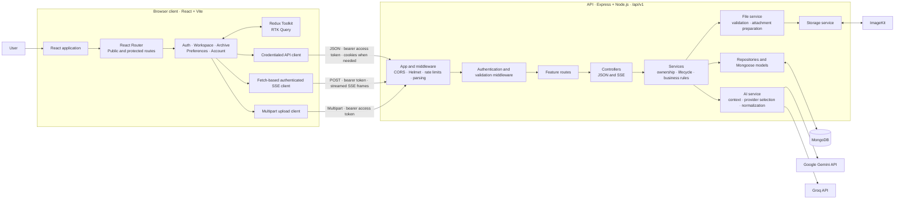

# Aira AI

Aira is a personal AI workspace for exploring ideas and getting work done. It combines a responsive chat interface with a versioned API, persistent conversation history, and model choices from Google Gemini and Groq.

> **Project status:** The core web client and API workflows are implemented. Client lint/build and server lint checks are available. Deployment-dependent behavior (database, cookies/CORS, file storage, and AI providers) still needs acceptance testing with real configuration. There is no maintained automated test suite at present.

## At a glance

- **Client:** React 19, Vite 7, React Router, Redux Toolkit/RTK Query, and Tailwind CSS 4.
- **API:** Node.js (ES modules), Express 5, Zod, and Mongoose 9.
- **Persistence:** MongoDB stores users, refresh sessions, chats, messages, and file metadata.
- **AI:** Gemini and Groq behind a provider-neutral service and adapter layer.
- **File storage:** ImageKit; Gemini chats can use supported attachments.
- **API base path:** `/api/v1`.

## Features

- Searchable conversations with pin, archive, rename, and delete controls.
- Incremental assistant replies over authenticated server-sent events (SSE), including stop, retry, and regenerate actions where eligible.
- Edit or delete user messages. Editing replaces the later conversation branch rather than appending a new version.
- Gemini attachments for images, PDFs, text, Markdown, JSON, XML, and YAML. Groq chats are text-only.
- Account page for display name, avatar, password changes, and sign-out; Preferences are for AI provider/model selection.
- Refresh-cookie session restoration, ownership checks, request validation, and provider-aware conversation context.

## Architecture

The diagram shows the main runtime boundaries and the direction of requests. The API separates HTTP handling from business rules and persistence; provider and storage integrations sit behind service abstractions.



### Request and data flow

1. The client calls the API under `/api/v1`. Protected requests carry a short-lived bearer access token; refresh and logout use the HTTP-only refresh cookie.
2. Middleware applies cross-cutting policies and validates/authenticates requests before feature routes call controllers.
3. Controllers translate HTTP input into service operations. Services enforce ownership and message/chat lifecycle rules, then use repositories for MongoDB access.
4. For generation, the message service builds bounded conversation context and calls the AI service. Provider adapters normalize Gemini/Groq responses and stream events.
5. For uploads, the file service validates the incoming file, stores it with ImageKit, and records its metadata in MongoDB. Gemini prepares supported attachments for model input.

### Backend layers

| Layer | Responsibility |
| --- | --- |
| Routes and middleware | Bind endpoints and apply authentication, validation, upload, rate-limit, and error policies. |
| Controllers | Handle HTTP concerns, response envelopes, SSE headers/frames, and disconnect signals. |
| Services | Enforce ownership, business rules, provider selection, and lifecycle transitions. |
| Repositories and models | Encapsulate MongoDB queries and define persisted schemas/indexes. |
| Integrations | Isolate Gemini, Groq, and ImageKit SDK behavior behind service/provider adapters. |

## Technology and repository layout

```text
client/
├── src/
│   ├── app/                 # Router setup
│   ├── features/            # Auth, chats, files, health, and messages
│   ├── layouts/             # Application shells
│   ├── routes/              # Public/protected route guards
│   ├── services/            # API and SSE clients
│   └── store/               # Redux store
├── .env.example
└── package.json

server/
├── src/
│   ├── config/              # Environment, database, and ImageKit setup
│   ├── middlewares/         # Auth, validation, uploads, errors, rate limits
│   ├── modules/             # AI, auth, chat, files, health, messages, users
│   ├── routes/               # API route aggregation
│   ├── services/storage/     # Storage-provider abstraction
│   ├── shared/               # Constants, errors, responses, utilities
│   ├── app.js                # Express middleware and route mounting
│   └── server.js             # Startup validation, DB connection, listener
├── .env.example
└── package.json
```

## Run locally

### Prerequisites

- Node.js **20.19+** or **22.12+** and npm.
- A reachable MongoDB instance.
- ImageKit credentials (validated when the API starts).
- At least one AI provider key: Gemini or Groq.

### Start the API

In a terminal:

```bash
cd server
cp .env.example .env
npm install
npm run dev
```

On Windows PowerShell, use `Copy-Item .env.example .env` instead of `cp`. Set `PORT=5000` and `CLIENT_URL=http://localhost:5173` in `server/.env`, and fill in the required credentials below.

### Start the client

In a second terminal:

```bash
cd client
cp .env.example .env
npm install
npm run dev
```

Open <http://localhost:5173>. `VITE_API_BASE_URL` should point to the API's `/api/v1` base path. The browser origin must match `CLIENT_URL` exactly for credentialed CORS requests.

### Environment variables

Use the checked-in `.env.example` files as the source of truth for variable names. Never commit secrets.

| Variable | Required | Purpose |
| --- | --- | --- |
| `MONGODB_URI` | Yes | MongoDB connection URI. |
| `CLIENT_URL` | Yes | Single browser origin allowed by CORS. |
| `JWT_ACCESS_SECRET` | Yes | Signs access tokens. |
| `JWT_REFRESH_SECRET` | Yes | Signs refresh tokens. |
| `IMAGEKIT_PUBLIC_KEY` | Yes | ImageKit public key. |
| `IMAGEKIT_PRIVATE_KEY` | Yes | ImageKit private key. |
| `IMAGEKIT_URL_ENDPOINT` | Yes | ImageKit URL endpoint. |
| `GEMINI_API_KEY` | One of the provider keys | Enables Gemini requests. |
| `GROQ_API_KEY` | One of the provider keys | Enables Groq requests. |
| `NODE_ENV` | No | Defaults to development. |
| `PORT` | No | API port; defaults to `5000`. |
| `ACCESS_TOKEN_EXPIRES` | No | Defaults to `15m`. |
| `REFRESH_TOKEN_EXPIRES` | No | Defaults to `7d`; positive integer with `s`, `m`, `h`, `d`, or `w` suffix. |
| `VITE_API_BASE_URL` | Client | Defaults in the client example to `http://localhost:5000/api/v1`. |

ImageKit configuration is required at API startup. At least one AI key is required, but selecting a provider whose key is not configured will fail when that provider is used.

## Development and verification

Run commands from the repository root:

```bash
npm --prefix client run lint
npm --prefix client run build
npm --prefix server run lint
```

The server package also defines `npm --prefix server test` using Node's built-in test runner. A maintained automated test suite is not currently configured. Lint/build checks do not replace authenticated acceptance tests against configured MongoDB, ImageKit, and AI providers.

## API overview

All endpoints are under `/api/v1`. Protected routes require `Authorization: Bearer <accessToken>` unless noted.

| Area | Routes | Notes |
| --- | --- | --- |
| Health | `GET /health` | Public liveness response. |
| Authentication | `POST /auth/register`, `/auth/login`, `/auth/refresh`, `/auth/logout` | Refresh/logout use the HTTP-only refresh cookie. |
| Account | `GET /users/me`, `PATCH /users/me`, `PATCH /users/me/password` | Current-user profile and password workflows. |
| Chats | `POST /chats`, `GET /chats`, `GET /chats/archived`, `GET /chats/:chatId`, `PATCH /chats/:chatId`, `DELETE /chats/:chatId` | Owned chat lifecycle, filtering, and pagination. |
| Messages | `POST /messages`, `POST /messages/stream`, `GET /messages/:chatId`, `PUT /messages/:messageId`, `DELETE /messages/:messageId` | Send, stream, retrieve, edit/resend, and delete. |
| Message actions | `POST /messages/:messageId/retry/stream`, `POST /messages/:messageId/regenerate` | Restricted to eligible latest assistant responses. |
| Files | `POST /files/upload` | One authenticated multipart file per request; max 10 MiB. |

JSON responses use a `{ success, message, data }` success envelope. Validation and other JSON errors use `{ success: false, message, errors }`. Streaming message endpoints return SSE frames (`chunk`, `done`, or `error`) instead of the JSON envelope.

## Provider and attachment support

| Provider | Supported models | Default model |
| --- | --- | --- |
| Gemini | `gemini-3.6-flash`, `gemini-3.5-flash-lite`, `gemini-3.1-flash-lite`, `gemini-3-flash-preview`, `gemini-2.5-flash` | `gemini-3.6-flash` |
| Groq | `openai/gpt-oss-20b`, `openai/gpt-oss-120b` | `openai/gpt-oss-20b` |

Models are validated against the provider. A message can reference up to 10 unique attachments; each upload is limited to 10 MiB and must be uploaded separately. Image/PDF/text-like attachments are supported in Gemini chats only; Groq attachment requests are rejected.

## Security and operational notes

- Passwords are bcrypt-hashed. Access tokens are returned to the client; refresh tokens are HTTP-only cookies, and only SHA-256 refresh-token hashes are stored in MongoDB.
- Refresh sessions can be revoked at logout and are checked for expiration, but refresh tokens are not rotated.
- CORS allows one configured origin and credentials. Production refresh cookies use `secure` and `sameSite=none`; deploy behind HTTPS.
- Helmet, a global rate limit, bounded JSON/file payloads, Zod validation, and service-level ownership checks are implemented.
- Per-chat mutation protection uses an in-memory lock. It prevents overlapping operations within one server process, not across multiple instances.

## Current limitations

- No shared workspaces, voice interface, billing, or native mobile app.
- No public file listing, retrieval, or deletion endpoint; deleting a chat does not remove its ImageKit files.
- The local storage provider is a stub; ImageKit is the active provider.
- No verified distributed mutation lock, refresh-token rotation, or automatic database TTL cleanup for expired sessions.
- Conversation summaries run asynchronously and may be discarded if the source history changes.
- No maintained automated test suite or end-to-end acceptance suite is configured.

## Contribution notes

Keep business rules in services, HTTP behavior in controllers/middleware, and persistence queries in repositories. Provider-specific request/response behavior belongs in the AI adapters. Do not commit `.env` files or credentials. Before submitting a change, run the available lint/build checks and document any deployment-dependent verification that could not be performed.
