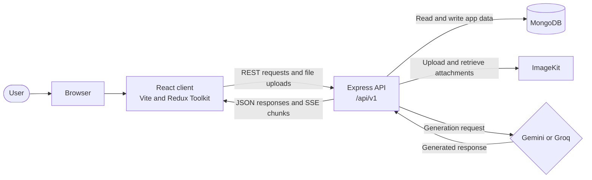

# Aira AI

A full-stack conversational AI web application supporting multiple LLM providers, real-time SSE response streaming, context-window summarization, and multimodal file attachments.


## Features

- **Multi-Provider AI Engine:** Switch seamlessly between **Groq** (`openai/gpt-oss-120b`, `openai/gpt-oss-20b`) and **Google Gemini** (`gemini-3.6-flash`, `gemini-3.5-flash-lite`, `gemini-3.1-flash-lite`, `gemini-3-flash-preview`, `gemini-2.5-flash`).
- **Real-Time Streaming:** Server-Sent Events (SSE) for token-by-token streaming, message editing, response regeneration, and stream retries.
- **Smart Context Management:** Automatic token tracking and background conversation summarization when chats exceed context thresholds.
- **Multimodal Attachments:** Upload and analyze images, PDFs, Markdown, and plain text files via **ImageKit** or local storage.
- **Chat Workspace:** Persistent chat history, auto-generated titles, archived chats, Markdown/GFM rendering, and syntax-highlighted code blocks.
- **Authentication & Security:** JWT access/refresh token rotation with HTTP-only cookies, Helmet, CORS, Zod validation, and rate limiting.

## Tech Stack


- **Frontend:** React 19, Vite, Redux Toolkit (RTK Query), React Router v7, Tailwind CSS v4, `react-markdown`, `lucide-react`
- **Backend:** Node.js, Express 5, MongoDB (Mongoose), Zod, Multer, `pdf-parse`
- **AI & Storage:** `@google/genai`, `groq-sdk`, ImageKit


## Folder Structure

The tree shows the main folders and entry/config files. Git ignore files, local `.env` files, dependencies, and generated build output are left out.

```text
aira-ai/
├── client/
│   ├── public/
│   ├── src/
│   │   ├── app/
│   │   ├── constants/
│   │   ├── features/
│   │   │   ├── auth/
│   │   │   │   └── pages/
│   │   │   ├── chats/
│   │   │   │   ├── components/
│   │   │   │   └── pages/
│   │   │   ├── files/
│   │   │   ├── health/
│   │   │   └── messages/
│   │   │       ├── components/
│   │   │       └── hooks/
│   │   ├── layouts/
│   │   ├── pages/
│   │   ├── routes/
│   │   ├── services/
│   │   │   ├── api/
│   │   │   └── streaming/
│   │   ├── store/
│   │   ├── utils/
│   │   ├── App.jsx
│   │   ├── main.jsx
│   │   └── index.css
│   ├── .env.example
│   ├── package.json
│   └── vite.config.js
├── server/
│   ├── src/
│   │   ├── config/
│   │   ├── middlewares/
│   │   ├── modules/
│   │   │   ├── ai/
│   │   │   │   ├── adapters/
│   │   │   │   ├── config/
│   │   │   │   ├── contracts/
│   │   │   │   ├── errors/
│   │   │   │   ├── providers/
│   │   │   │   ├── services/
│   │   │   │   └── utils/
│   │   │   │       └── handlers/
│   │   │   ├── auth/
│   │   │   ├── chat/
│   │   │   ├── files/
│   │   │   ├── health/
│   │   │   ├── messages/
│   │   │   └── users/
│   │   ├── routes/
│   │   ├── services/
│   │   │   └── storage/
│   │   │       └── providers/
│   │   ├── shared/
│   │   │   ├── constants/
│   │   │   ├── errors/
│   │   │   ├── responses/
│   │   │   └── utils/
│   │   ├── app.js
│   │   └── server.js
│   ├── .env.example
│   └── package.json
└── README.md
```

The client groups code by feature. The server keeps API features in `modules/`, with shared configuration, middleware, storage, and helpers alongside them. The two apps have separate dependencies and environment files.

## System Architecture



The client sends API requests to the server. The server reads and writes app data in MongoDB, stores uploaded files in ImageKit, and passes chat prompts to the selected AI provider. Streaming replies are sent back to the client over SSE.

## clone the repo

```bash
git clone https://github.com/ShivanshPawar/aira-ai.git
cd aira-ai
```

From the repository root, open two terminals. In the first, set up and start the server:

```bash
cd server
npm install
cp .env.example .env
```

Add your MongoDB, JWT, ImageKit, and at least one AI provider key to `server/.env`, then run:

```bash
npm run dev
```

In the second terminal, set up and start the client:

```bash
cd client
npm install
cp .env.example .env
npm run dev
```

The client uses `http://localhost:5000/api/v1` by default. Set `CLIENT_URL` in `server/.env` to the client URL shown by Vite (usually `http://localhost:5173`).

### Environment variables
Use `server/.env.example` for API settings and `client/.env.example` for `VITE_API_BASE_URL`.

| Variable | Required | Purpose |
| --- | --- | --- |
| `MONGODB_URI` | Yes | MongoDB connection URI. |
| `CLIENT_URL` | Yes | Single browser origin allowed by CORS. |
| `JWT_ACCESS_SECRET` | Yes | Signs access tokens. |
| `JWT_REFRESH_SECRET` | Yes | Signs refresh tokens. |
| `IMAGEKIT_PUBLIC_KEY` | Yes | ImageKit public key. |
| `IMAGEKIT_PRIVATE_KEY` | Yes | ImageKit private key. |
| `IMAGEKIT_URL_ENDPOINT` | Yes | ImageKit URL endpoint. |
| `GEMINI_API_KEY` | One of the provider keys | Enables Gemini requests. |
| `GROQ_API_KEY` | One of the provider keys | Enables Groq requests. |
| `NODE_ENV` | No | Defaults to development. |
| `PORT` | No | API port; defaults to `5000`. |
| `ACCESS_TOKEN_EXPIRES` | No | Defaults to `15m`. |
| `REFRESH_TOKEN_EXPIRES` | No | Defaults to `7d`; positive integer with `s`, `m`, `h`, `d`, or `w` suffix. |
| `VITE_API_BASE_URL` | Client | Defaults in the client example to `http://localhost:5000/api/v1`. |

ImageKit configuration is required at API startup. At least one AI key is required, but selecting a provider whose key is not configured will fail when that provider is used.


## API overview

All endpoints are under `/api/v1`. Protected routes require `Authorization: Bearer <accessToken>` unless noted.

| Area | Routes | Notes |
| --- | --- | --- |
| Health | `GET /health` | Public liveness response. |
| Authentication | `POST /auth/register`, `/auth/login`, `/auth/refresh`, `/auth/logout` | Refresh/logout use the HTTP-only refresh cookie. |
| Account | `GET /users/me`, `PATCH /users/me`, `PATCH /users/me/password` | Current-user profile and password workflows. |
| Chats | `POST /chats`, `GET /chats`, `GET /chats/archived`, `GET /chats/:chatId`, `PATCH /chats/:chatId`, `DELETE /chats/:chatId` | Owned chat lifecycle, filtering, and pagination. |
| Messages | `POST /messages`, `POST /messages/stream`, `GET /messages/:chatId`, `PUT /messages/:messageId`, `DELETE /messages/:messageId` | Send, stream, retrieve, edit/resend, and delete. |
| Message actions | `POST /messages/:messageId/retry/stream`, `POST /messages/:messageId/regenerate` | Restricted to eligible latest assistant responses. |
| Files | `POST /files/upload` | One authenticated multipart file per request; max 10 MiB. |

JSON responses use a `{ success, message, data }` success envelope. Validation and other JSON errors use `{ success: false, message, errors }`. Streaming message endpoints return SSE frames (`chunk`, `done`, or `error`) instead of the JSON envelope.


## Provider and attachment support

| Provider | Supported models | Default model |
| --- | --- | --- |
| Gemini | `gemini-3.6-flash`, `gemini-3.5-flash-lite`, `gemini-3.1-flash-lite`, `gemini-3-flash-preview`, `gemini-2.5-flash` | `gemini-3.6-flash` |
| Groq | `openai/gpt-oss-20b`, `openai/gpt-oss-120b` | `openai/gpt-oss-20b` |

Models are validated against the provider. A message can reference up to 10 unique attachments; each upload is limited to 10 MiB and must be uploaded separately. Image/PDF/text-like attachments are supported in Gemini chats only; Groq attachment requests are rejected.

---

## Author

> **Shivansh Pawar** [🔗](https://www.linkedin.com/in/shivansh-pawar-853355322/)