# Aira AI - Product & Technical Documentation

## 1. Document Information

| Item | Value |
| --- | --- |
| Project | Aira AI |
| Status | Backend implementation is complete and hardened according to the project status documentation; this document is the verified backend reference. |
| Purpose | Product, architecture, API, and frontend-integration reference for the current backend. |
| Scope | `server/` application source, configuration templates, package scripts, and existing backend documentation. |
| Last updated | 2026-09-10 |
| Backend status | Implemented: Express API, MongoDB persistence, authentication, chat, AI generation, SSE, uploads, and provider abstraction. |
| Frontend status | Not implemented or verified in this backend documentation pass. Frontend development is the next documented phase. |
| Technology stage | Backend contract established; frontend integration can begin against the API documented here. |

This is a documentation-only artifact. It describes the repository as inspected and does not represent a roadmap as implementation.

## 2. Product Overview

Aira AI is a persistent AI chat backend. It lets authenticated users create and manage chats, send messages to selected AI providers, receive complete JSON responses or streamed SSE responses, attach supported files to Gemini conversations, and retain message, token, and summary metadata in MongoDB.

The shared system prompt presents Aira as an "AI Buddy for Humans" intended to help with understanding, creating, solving, deciding, learning, and completing work. No narrower target audience is formally documented or verified.

Current capabilities are limited to the implemented backend contract: text chat, Gemini and Groq generation, chat management, authentication, file upload, and conversation memory through summaries. The repository does not implement RAG, embeddings, vector search, web search, agents, tool calling, voice, image generation, payments, subscriptions, collaboration, an admin dashboard, or a mobile client.

## 3. Product Vision & Goals

### Current implemented goals

- Provide a protected, persistent AI-chat API with a clear frontend contract.
- Support provider-specific generation through one normalized application interface.
- Preserve conversation continuity with chronological history, bounded context windows, and asynchronous summaries.
- Provide resilient generation states: completed, failed, and cancelled responses remain visible and can be handled safely.
- Accept user-owned files for Gemini conversations without silently passing attachments to unsupported providers.

### Future/product direction

The documented next phase is frontend development. No frontend design, client framework, or additional product capability is verified in the backend repository.

## 4. Core Features

| Feature | Status | Verified behavior |
| --- | --- | --- |
| Health check | Implemented | Public liveness response at `/api/v1/health`. |
| Authentication | Implemented | Registration, login, bearer access tokens, refresh-cookie sessions, refresh, and logout. |
| User profile | Implemented | Protected current-user endpoint. |
| Chat management | Implemented | Create, list, search, filter, paginate, retrieve, update, rename, pin, archive, and delete owned chats. |
| AI generation | Implemented | Non-stream generation through Gemini or Groq adapters. |
| Streaming | Implemented | SSE token chunks, completion event, and safe error event. |
| Cancellation | Implemented | Client disconnect aborts an active SSE generation and preserves partial content as `CANCELLED`. |
| Retry | Implemented | Latest failed or cancelled assistant response can be retried through SSE. |
| Regenerate | Implemented | Latest assistant response can be replaced with a new generated response. |
| Edit and resend | Implemented | User messages can be edited; later messages are removed and a replacement response is generated. |
| Attachments | Implemented | One ImageKit-backed upload per request; supported attachments are processed for Gemini only. |
| Token accounting | Implemented | Message and chat prompt/completion/total usage are persisted when supplied by providers. |
| Context management | Implemented | Completed history is bounded by provider-specific estimated token budgets. |
| Conversation summaries | Implemented | Background summaries are generated after token thresholds and guarded against stale history. |
| In-process mutation protection | Implemented | Per-chat lock rejects overlapping message mutations in one server process. |

## 5. Technology Stack

### Backend

- Node.js with ECMAScript modules.
- Express 5.
- `morgan` request logging outside production.
- `dotenv` configuration loading.

### Database

- MongoDB through Mongoose 9.

### Authentication

- `bcrypt` password hashing.
- `jsonwebtoken` access and refresh JWTs.
- `cookie-parser` for refresh-token cookies.

### AI

- Google GenAI SDK (`@google/genai`) for Gemini.
- Groq SDK (`groq-sdk`) for Groq chat completions.
- `axios` for downloading stored attachment content before Gemini processing.

### File Handling

- `multer` memory storage for multipart intake.
- ImageKit storage provider.
- `pdf-parse` for PDF text extraction.

### Validation and Security

- Zod request validation.
- Helmet security headers.
- `express-rate-limit` global rate limiting.
- CORS configured for one environment-supplied client origin.

### Development Tools

- ESLint 10.
- Prettier.
- Nodemon.

### Testing

No test runner script and no automated test files were found under `server/`. The existing status report records prior live and controlled-provider verification; see [Testing & Verification](#38-testing--verification).

## 6. System Architecture

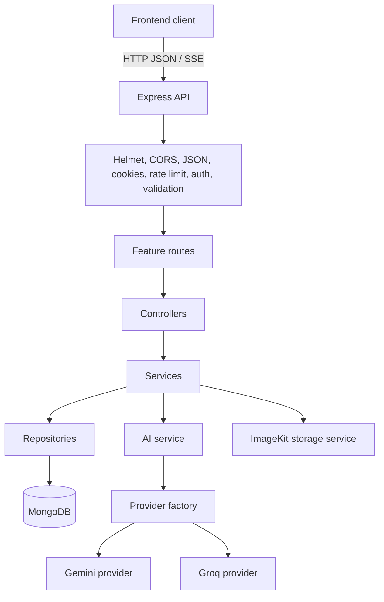

The server mounts all versioned routes below `/api/v1`. Controllers translate HTTP concerns into service calls. Services own authorization, lifecycle, and business rules. Repositories isolate Mongoose operations. AI and storage providers are selected behind small application contracts.

## 7. Backend Architecture

| Layer | Responsibility | Examples |
| --- | --- | --- |
| Routes | Bind HTTP method/path to middleware and controller. | `auth.routes.js`, `message.routes.js` |
| Middleware | Apply cross-cutting HTTP policy before controllers. | auth, Zod validation, uploads, rate limits, errors |
| Controllers | Read request data, configure JSON/SSE responses, call services. | streaming controller owns `AbortController` and SSE writes |
| Services | Enforce ownership, lifecycle transitions, provider decisions, and business rules. | chat, message, auth, file services |
| Repositories | Run database queries and updates. | Mongoose repositories per module |
| Models | Define MongoDB schema fields, references, indexes, and hooks. | User, Session, Chat, Message, File |
| Shared utilities | Reusable JWT, cookie, token-hash, query, response, and title helpers. | `shared/utils/` |
| Configuration | Read environment values and initialize database/ImageKit SDKs. | `config/` |

Errors from async handlers reach the global error middleware. Expected `ApiError` instances retain their status and safe message; unexpected 5xx failures are rendered as `Internal Server Error`.

## 8. Project Directory Structure

```text
server/
├── docs/
│   ├── AIRA_AI_PROJECT_DOCUMENTATION.md
│   ├── API_ENDPOINTS.md
│   ├── AUTH_FLOW.md
│   ├── BACKEND_STATUS_REPORT.md
│   └── GROQ_INVALID_ROLE_ROOT_CAUSE*.md
├── src/
│   ├── config/                 # Environment, MongoDB, ImageKit
│   ├── middlewares/            # Auth, validation, uploads, errors, rate limit
│   ├── modules/
│   │   ├── ai/                 # Providers, adapters, context, summaries
│   │   ├── auth/               # Credentials and refresh sessions
│   │   ├── chat/               # Chat lifecycle and metadata
│   │   ├── files/              # Upload validation and file records
│   │   ├── health/             # Liveness endpoint
│   │   ├── messages/           # Message lifecycle and SSE
│   │   └── users/              # Current-user lookup and user schema
│   ├── routes/                 # Version-level route aggregation
│   ├── services/storage/       # Storage-provider abstraction
│   ├── shared/                 # Constants, errors, responses, utilities
│   ├── app.js                  # Express middleware and route mounting
│   └── server.js               # Environment validation, DB connection, listener
├── .env.example
├── eslint.config.js
└── package.json
```

## 9. Authentication & Authorization

### Authentication model

- Registration and login issue a short-lived access JWT and a refresh JWT.
- The access token is returned in JSON and must be sent as `Authorization: Bearer <accessToken>` to protected endpoints.
- The refresh token is set only as the HTTP-only `refreshToken` cookie.
- The database stores a SHA-256 hash of the refresh token, never the raw refresh credential.
- A refresh session stores `user`, token digest, user agent, IP address, `isRevoked`, timestamps, and `expiresAt`.
- Refresh verifies both the refresh JWT and a non-revoked, non-expired matching session before issuing a new access token.
- Logout validates the same session, marks it revoked, and clears the refresh cookie.
- Refresh does not rotate the refresh token or create a replacement refresh session.

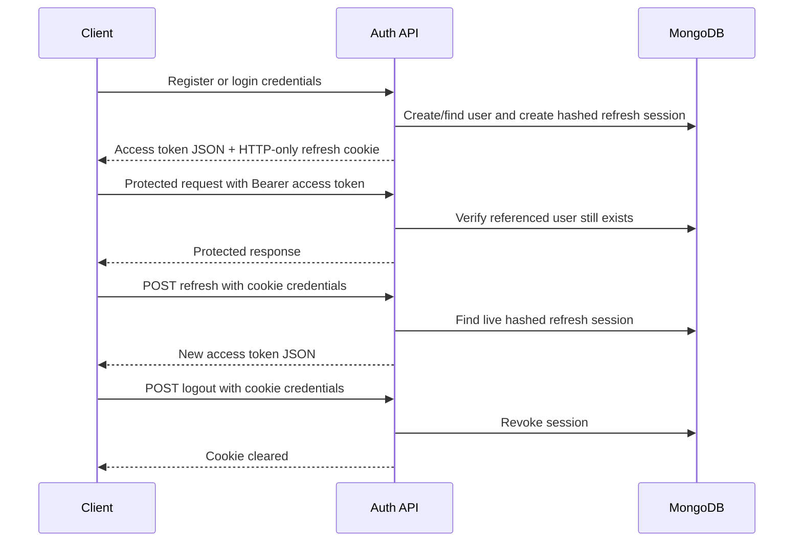

### Cookie and CORS behavior

| Environment | `secure` | `sameSite` | Other options |
| --- | --- | --- | --- |
| Development | `false` | `lax` | `httpOnly: true`, `maxAge: REFRESH_TOKEN_MAX_AGE` |
| Production | `true` | `none` | `httpOnly: true`, `maxAge: REFRESH_TOKEN_MAX_AGE` |

The CORS policy permits only `CLIENT_URL`, enables credentials, and allows `GET`, `HEAD`, `PUT`, `PATCH`, `POST`, `DELETE`, and `OPTIONS` with `Content-Type` and `Authorization` headers. Browser calls that use refresh/logout must opt into credentials.

### Authorization and ownership

`protect` verifies the access JWT, loads the user by JWT `sub`, and puts only `userId` and `role` on `req.auth`. Chat access is checked in `chatService`; message access resolves the owning chat and reuses that check; attachment ownership is checked before provider processing. This prevents cross-user chat, message, and file attachment access through service entry points.

## 10. User Management

Current user functionality is intentionally narrow:

- Users are created through registration.
- `GET /api/v1/users/me` returns the authenticated user's serialized record.
- User passwords are hidden by the model's `toJSON` transform.
- The schema contains `LOCAL` and `GOOGLE` auth-provider enum values, but no Google/OAuth route or flow is implemented or verified.

## 11. Chat System

### Lifecycle and metadata

A new chat begins with title `New Chat`, the selected/default provider and model, zero messages, zero token usage, no summary, and no last-message fields. Its title changes automatically only while it remains `New Chat`; the title generator uses keywords from the first user message and returns at most five title-cased keywords.

Users can retrieve only their own chats. Listing separates active and archived chats. The default listing sort is pinned chats first, then newest `lastMessageAt` first.

### Provider and model rules

| Provider | Accepted models | Default when chosen without a model |
| --- | --- | --- |
| `GEMINI` | `gemini-2.5-flash` | `gemini-2.5-flash` |
| `GROQ` | `openai/gpt-oss-120b`, `groq/compound`, `groq/compound-mini` | `groq/compound` |

Create and update validators reject incompatible provider/model pairs. Updating only the provider selects that provider's default model. Updating only a model validates it against the chat's current provider. The schema has a `systemPrompt` field, but no current public chat request schema exposes it for create or update.

### Listing

- `page`: integer, minimum 1, default 1.
- `limit`: integer 1-100, default 20.
- `search`: case-insensitive title regex, trimmed, 1-120 characters.
- `provider`, `model`, `isPinned`: optional filters.
- The response includes `items`, `page`, `limit`, `totalItems`, `totalPages`, `hasNextPage`, and `hasPreviousPage`.

Deleting a chat acquires the mutation lock, removes all its messages, then removes the chat. File records and remote ImageKit copies are not deleted as part of chat deletion.

## 12. Message System

### Roles and statuses

| Type | Values | Meaning |
| --- | --- | --- |
| Role | `USER`, `ASSISTANT`, `SYSTEM` | Stored message role. Public send/edit flows create user messages; AI flows create assistant messages. |
| Status | `GENERATING` | Assistant placeholder is persisted before provider work. |
| Status | `COMPLETED` | User messages and completed assistant output. |
| Status | `FAILED` | Provider/generation failure; partial text and error metadata may remain. |
| Status | `CANCELLED` | Client-aborted stream; partial text and cancellation metadata remain. |

Each message can store content, attachment references, provider, model, token usage, finish reason, latency, safety metadata, and error metadata (`code`, `message`, `retryable`). Messages are read chronologically by `createdAt`, then `_id` as a same-millisecond tie-breaker.

### Core behavior

- Non-stream send creates a completed user message, then an assistant placeholder. A successful provider result changes the placeholder to `COMPLETED`; a failure changes it to `FAILED` and the HTTP request returns an error.
- Stream send creates the same two message records, but appends provider text in memory and writes SSE chunks. The assistant record is completed only after the stream ends.
- Retrieval requires access to the parent chat and populates attachment records.
- Delete removes one owned message and recomputes chat message count and last-message metadata. It does not delete a later branch or refund historical token usage.

## 13. AI Architecture

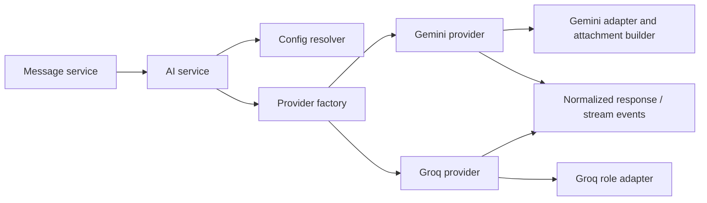

The application builds a provider-neutral conversation with lower-case `user`, `assistant`, and `system` roles. The AI service merges defaults and caller options, selects a provider through the factory, and invokes the provider contract (`generateResponse` or `generateStream`). Providers normalize their provider-specific response fields into application response and stream shapes.

This abstraction keeps message services independent of Gemini and Groq SDK details, including role labels, token fields, streaming chunk formats, and error structures.

### Normalized forms

Non-stream provider responses use:

```json
{
	"content": "...",
	"provider": "GROQ",
	"model": "groq/compound",
	"finishReason": "...",
	"usage": { "prompt": 0, "completion": 0, "total": 0 }
}
```

Internal stream events use `token`, `done`, and `error` types. The HTTP SSE controller maps provider token events to client-facing `chunk` events and maps a completed stored message to a client-facing `done` event.

## 14. Gemini Integration

- Supported model: `gemini-2.5-flash`.
- Default options: temperature `0.7`, maximum output `8192`, top-p `0.95`, top-k `40`.
- The provider uses `GoogleGenAI.models.generateContent` for complete responses and `generateContentStream` for streams.
- A non-null system prompt is passed as Gemini `systemInstruction`.
- The Gemini adapter changes application assistant messages to Gemini's `model` role. Other adapter messages are supplied as user input.
- Gemini is the only provider that processes stored attachments. Images become inline base64 data; PDFs, text, and Markdown become text parts.
- The provider passes the request abort signal as `abortSignal`.
- Prompt, completion, and total token counts are read from Gemini usage metadata when supplied.

## 15. Groq Integration

- Supported models: `openai/gpt-oss-120b`, `groq/compound`, and `groq/compound-mini`.
- Default model/options: `groq/compound`, temperature `0.7`, maximum completion tokens `2048`, top-p `1`.
- Groq uses chat completions for complete and streaming generation.
- The adapter lower-cases and restricts roles to valid Groq `user`, `assistant`, and `system` values. A truthy configured system prompt is prepended as a system message.
- The streaming request enables `stream_options.include_usage` so final usage can be captured when Groq supplies it.
- The abort signal is passed to the SDK request when present.
- Attachments are rejected before a Groq request is made. They are not silently dropped.

The historical uppercase-role issue is resolved by the current Groq role adapter. See [Historical Troubleshooting Notes](#42-historical-troubleshooting-notes).

## 16. Conversation Context Management

Before each provider call, the message service loads chronological history and calls `buildConversation`.

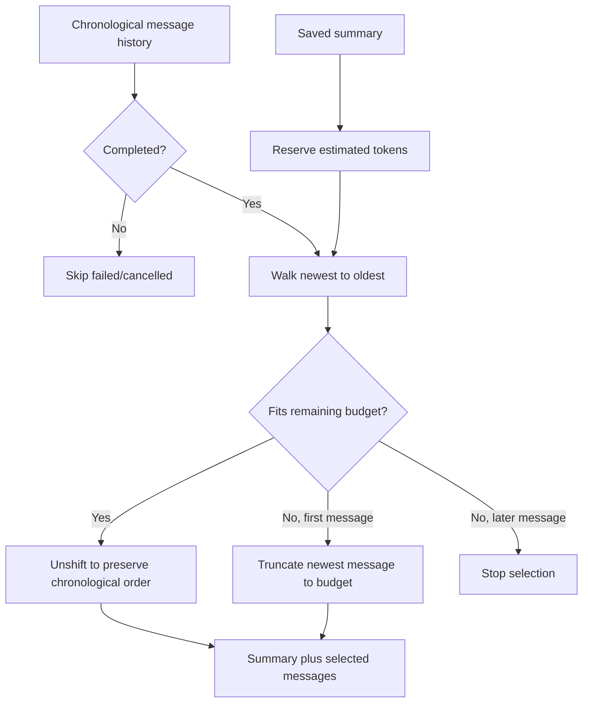

Rules verified in code:

- Only messages with no status or `COMPLETED` status are included.
- The saved summary, when non-empty, is inserted as a `SYSTEM` context message before selected raw messages.
- Token estimation is approximate: `ceil(characterCount / 3)`.
- The selected raw history is traversed newest first, but `unshift` restores chronological order for the provider.
- If the newest single message is larger than the remaining budget, it is truncated instead of producing empty raw context.
- Gemini uses `MAX_CONTEXT_TOKENS` (`120000`); Groq uses `GROQ_CONTEXT_TOKENS` (`7000`).
- Attachments travel with selected messages. Gemini converts supported attachment types; Groq attachment requests never reach this stage because they are rejected earlier.

## 17. Conversation Summarization

Summary generation is a best-effort background task after a successful assistant response.

| Setting | Value | Use |
| --- | --- | --- |
| Initial threshold | `100000` total chat tokens | First summary starts only after this threshold. |
| Later interval | `20000` tokens | A later summary is eligible after this much usage beyond the saved summary checkpoint. |
| Summary input budget | `7000` estimated tokens | Recent completed history supplied to the summary prompt. |
| Summary output budget | `512` tokens | Maximum output requested from the AI provider. |

The summary uses the chat's provider and model and sets `systemPrompt: null`, so the normal Aira persona is deliberately omitted. It keeps recent completed messages within its input budget and asks for durable preferences, projects, decisions, facts, and unresolved tasks.

Only one background summary task runs per chat in a server process. The service snapshots the source message count and final message ID before generation. It increments chat token usage for the summary provider call, then saves the new summary only if the message count and final message ID still match. If history changed, the generated summary is discarded as stale. Failures are logged to the server console and do not reverse a completed assistant response.

`SUMMARY_KEEP_TOKENS` is defined in the AI constants but is not referenced by the inspected implementation.

## 18. Streaming Architecture

### Endpoint and wire format

`POST /api/v1/messages/stream` accepts the same JSON body as non-stream send and requires a bearer token. It returns an SSE response with these headers:

- `Content-Type: text/event-stream`
- `Cache-Control: no-cache`
- `Connection: keep-alive`

Client frames are JSON in the SSE `data:` field:

```text
data: {"type":"chunk","content":"partial text"}

data: {"type":"done","messageId":"<assistant-message-id>"}

data: {"type":"error","message":"AI response generation failed.","code":"..."}
```

The `code` property is included by the retry-stream controller when that controller catches an error before its normal callback path. The normal stream callback error frame contains `type` and `message`.

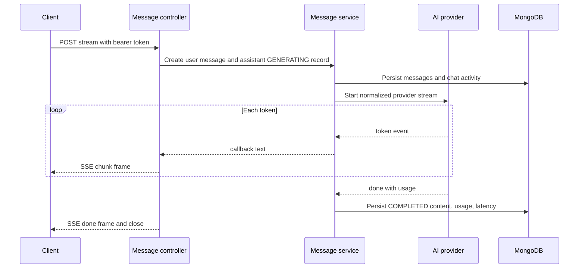

## 19. Cancellation Architecture

There is no separate cancellation endpoint. Cancellation is driven by an aborted request or an SSE response closing before it ends normally.

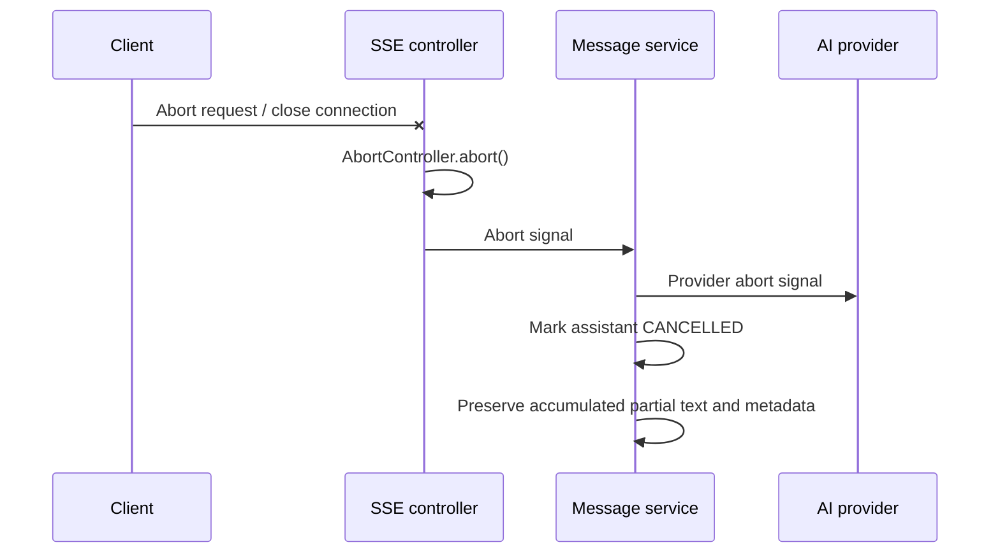

The message service checks the abort signal during and after stream consumption. A cancelled assistant record stores partial content, `finishReason: "cancelled"`, latency, and error metadata with code `AI_GENERATION_CANCELLED` and `retryable: false`. When the client has already disconnected, the controller does not attempt to write an SSE error frame.

## 20. Retry Architecture

`POST /api/v1/messages/:messageId/retry/stream` retries only an owned assistant message when all of these conditions hold:

- It has status `FAILED` or `CANCELLED`.
- It is the latest message in its chat.
- A preceding user message exists.

The original failed/cancelled assistant message remains stored. Retry creates a new `GENERATING` assistant message and excludes the original target message from the new provider context, preventing the failed/cancelled attempt from being sent back to the provider. The new response is streamed through the same SSE lifecycle and can itself be cancelled by disconnecting.

## 21. Regenerate Architecture

`POST /api/v1/messages/:messageId/regenerate` is a non-stream replacement flow.

1. The service verifies message ownership through its chat.
2. The target must be an assistant message and the latest message in the chat.
3. The service finds the immediately preceding user message, accounting for `createdAt` ties with `_id` ordering.
4. It deletes the old assistant message.
5. It generates and persists a new assistant response using the resulting conversation history.
6. It synchronizes chat message count and last-message metadata.

The response returns the preceding user message and the new assistant message. A non-latest assistant message cannot be regenerated because that would create an unsupported hidden branch.

## 22. Edit & Resend Architecture

`PUT /api/v1/messages/:messageId` is available only for owned `USER` messages.

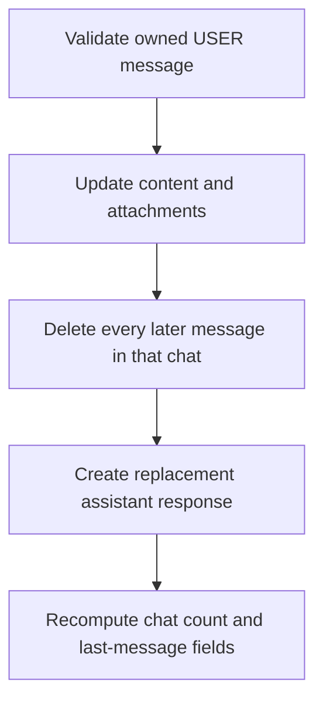

The endpoint validates the replacement attachment IDs and provider restriction before changing the message. It then removes every later message using timestamp and `_id` tie-break rules, generates a new assistant response, and synchronizes chat metadata. Only the edited user message remains from the old branch; all later user and assistant messages are removed.

## 23. File & Attachment System

### Upload contract

- Endpoint: `POST /api/v1/files/upload`.
- Authentication: bearer token required.
- Input: multipart/form-data containing exactly one file, under any field name.
- Size: maximum 10 MiB (`10 * 1024 * 1024` bytes).
- Storage: Multer memory storage, then ImageKit folder `/aira-ai`.
- The response creates a `File` record with owner, original and generated names, MIME type, extension, category, ImageKit IDs/URLs, size, provider, and `READY` status.

### Supported MIME categories

The upload allow-list accepts `image/*`, `application/pdf`, `text/*`, plus `application/json`, `application/xml`, `application/yaml`, and `application/x-yaml`. Filename fallback mapping exists for common image extensions, PDF, CSV, log, Markdown, TXT, JSON, XML, YAML, and YML when a client reports `application/octet-stream` or no MIME type. Markdown `.md`/`.markdown` is normalized from plain/binary reporting to `text/markdown`.

The implementation has explicit content checks for JPEG, PNG, WebP, GIF, BMP, ICO, PDF, TIFF, AVIF, HEIC/HEIF, and SVG. Text-category files are rejected when their buffer contains a NUL byte. The broad `image/*` allow-list is wider than the explicit signature table; unrecognized image MIME types have no additional listed signature branch in the current code.

### Attachment use

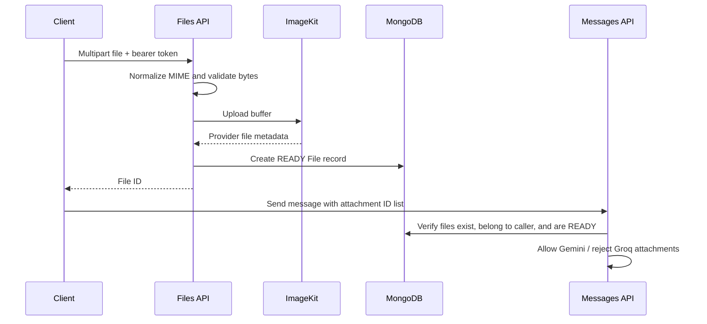

For Gemini, images are downloaded and supplied as inline base64 data. PDFs are downloaded and text-extracted; PDFs with no extracted text yield an explanatory text part. Plain text and Markdown are downloaded as text. PDF, text, and Markdown content is capped at 50,000 characters. Unsupported persisted file categories are skipped by the Gemini attachment builder, but public upload validation presently produces the supported image/document/text/Markdown categories.

The file service has a delete helper that removes ImageKit first and then the database record, but no file-delete route is currently mounted. The `LOCAL` storage provider exists as a stub and throws `Not implemented`; current upload calls ImageKit explicitly.

## 24. Token Usage & Accounting

Each assistant message stores:

```json
{
	"tokenUsage": {
		"prompt": 0,
		"completion": 0,
		"total": 0
	}
}
```

Each chat stores cumulative fields with the same names. Provider values are normalized to non-negative integers. If a provider total is missing or smaller than `prompt + completion`, the stored total becomes the larger of the reported total and that sum. Missing/invalid values normalize to zero.

- Completed assistant generations increment chat usage with their normalized provider usage.
- Stream completion does the same after the final event.
- Summary provider calls also increment chat usage, even if the generated summary is later discarded as stale.
- Deleting, regenerating, retrying, or editing messages does not decrement previous chat token usage. The total represents historical API consumption, not the token sum of messages currently visible in the chat.

## 25. Chat Metadata Consistency

Chat metadata includes `messageCount`, `lastMessage`, `lastMessageAt`, cumulative `tokenUsage`, and summary checkpoint data.

| Operation | Metadata behavior |
| --- | --- |
| Normal send | User message increments activity/count; assistant placeholder increments it again. Completion/failure keeps that assistant as the latest message. |
| Stream send | Same initial count/activity updates; final status update changes the same assistant record. |
| Cancellation | The assistant remains latest with `CANCELLED`; partial content does not change the count. |
| Retry | Old failed/cancelled assistant remains; new assistant creation increments the count. |
| Regenerate | Old assistant is deleted, new assistant is created, then count/last-message values are recomputed. |
| Edit and resend | Later branch is deleted, replacement assistant is created, then count/last-message values are recomputed. |
| Delete message | Count and last-message values are recomputed after deletion. |
| Delete chat | Messages are deleted before the chat itself. |

Failures before an assistant placeholder exists cannot update a message record. For example, authorization or attachment validation fails before creating new message records.

## 26. Concurrency & Race Protection

The chat service uses an in-memory `Set` keyed by chat ID. A second protected mutation for the same chat immediately receives `409 Conflict` with `Another message operation is already in progress for this chat.`

Protected operations are normal send, stream send, retry stream, regenerate, edit and resend, delete message, and delete chat. The stream lock lasts for the provider stream because the mutation work waits for stream completion.

This is process-local protection only. Multiple Node.js instances do not share the set, so horizontal deployments require a distributed lock, queue, or transaction-aware coordination mechanism for cross-instance serialization.

## 27. Error Handling

### JSON error contract

```json
{
	"success": false,
	"message": "...",
	"errors": null
}
```

Zod validation errors use `400` and an `errors` array of `{ "field": "...", "message": "..." }`. Other expected and unexpected JSON errors use `errors: null`.

| Situation | Status | Current response behavior |
| --- | --- | --- |
| Request validation | 400 | `Validation Error` plus field-level `errors`. |
| Expected business rule (`ApiError`) | Varies | Safe service message and its status, such as 400/401/403/404/409. |
| Missing/expired access token | 401 | Safe JWT/auth message. |
| Ownership failure | 403 | Safe service message. |
| Unknown route | 404 | `Route not found: <originalUrl>`. |
| Mutation collision | 409 | Conflict from the in-process chat lock. |
| Oversized JSON/file | 413 | `Request payload exceeds the allowed limit.` |
| One-file Multer limit | 400 | `Only one file can be uploaded per request.` |
| Rate limit | 429 | `Too many requests. Please try again later.` |
| AI rate limit | 429 | Normalized as retryable provider error; JSON error middleware may retain status but sanitizes 5xx only. |
| AI authentication/generic provider issue | 502 | Safe generic 5xx JSON message; SSE exposes generic generation failure text. |
| AI timeout | 504 | Safe generic 5xx JSON message; retryable provider metadata is retained internally. |
| Cancellation exception | 499 | Internal cancellation error status; a disconnected SSE client receives no final frame. |
| Unexpected server failure | 500 | `Internal Server Error`, without internal error details. |

SSE responses do not use the JSON envelope after headers/chunks are sent. The global error middleware delegates if headers have already been sent to avoid corrupting the stream.

## 28. API Documentation

Base path: `/api/v1`. All request bodies below are JSON unless explicitly marked multipart.

### Health and users

| Method | Path | Auth | Request / parameters | Success response | Important errors and notes |
| --- | --- | --- | --- | --- | --- |
| GET | `/health` | No | None | `200`, health object with `status`, `version`, `timestamp` | Global rate limit still applies. |
| GET | `/users/me` | Bearer | None | `200`, serialized current user | `401` missing/invalid token; `404` if user record no longer exists. |

### Authentication

| Method | Path | Auth | Request body | Success response | Important errors and notes |
| --- | --- | --- | --- | --- | --- |
| POST | `/auth/register` | No | `name` 3-50, normalized `email`, `password` 8-50 | `201`, `{ user, accessToken }` plus refresh cookie | `409` if email exists; strict body/query/params validation. |
| POST | `/auth/login` | No | normalized `email`, non-empty `password` | `200`, `{ user, accessToken }` plus refresh cookie | `401` uses one message for invalid email or password. |
| POST | `/auth/refresh` | Refresh cookie | No body | `200`, `{ accessToken }` | `401` for missing/invalid JWT, unknown/revoked/expired session, or missing user. No rotation. |
| POST | `/auth/logout` | Refresh cookie | No body | `200`, `data: null`; clears cookie | Validates/revokes session first; `401` if cookie/session is invalid. |

### Chats

| Method | Path | Auth | Body / params / query | Success | Notes |
| --- | --- | --- | --- | --- | --- |
| POST | `/chats` | Bearer | Body: optional `provider`, `model` | `201`, chat | Strict compatible provider/model pair. |
| GET | `/chats` | Bearer | Query: `page`, `limit`, `search`, `provider`, `model`, `isPinned` | `200`, paginated active chats | Default sort: pinned then newest activity. |
| GET | `/chats/archived` | Bearer | Same list query | `200`, paginated archived chats | Archived only. |
| GET | `/chats/:chatId` | Bearer | 24-hex `chatId` | `200`, chat | Owned chat only. |
| PATCH | `/chats/:chatId` | Bearer | One or more: `title` 1-120, `isPinned`, `isArchived`, `provider`, `model` | `200`, chat | Updates only this allow-list; provider-only change selects provider default model. |
| PATCH | `/chats/:chatId/rename` | Bearer | `title` 1-100 | `200`, chat | Dedicated title change. |
| PATCH | `/chats/:chatId/pin` | Bearer | No body | `200`, chat | Toggles current pin state. |
| PATCH | `/chats/:chatId/archive` | Bearer | No body | `200`, chat | Toggles current archive state. |
| DELETE | `/chats/:chatId` | Bearer | 24-hex `chatId` | `200`, deleted chat | Deletes messages first; mutation lock applies. |

### Messages

Message send/stream body:

```json
{
	"chatId": "24-character Mongo ObjectId",
	"content": "1 to 10000 trimmed characters",
	"attachments": ["up to 10 unique File IDs"]
}
```

| Method | Path | Auth | Success | Important errors and notes |
| --- | --- | --- | --- | --- |
| POST | `/messages` | Bearer | `201`, `{ userMessage, assistantMessage }` | Generates a complete response; provider failure records `FAILED` assistant and returns an error. |
| POST | `/messages/stream` | Bearer | SSE `200` stream | Emits `chunk`, then `done`, or `error`; client disconnect cancels. |
| POST | `/messages/:messageId/regenerate` | Bearer | `200`, `{ userMessage, assistantMessage }` | Only latest owned assistant response. |
| PUT | `/messages/:messageId` | Bearer | `200`, `{ userMessage, assistantMessage }` | Only owned user message; later branch is deleted. |
| POST | `/messages/:messageId/retry/stream` | Bearer | SSE `200` stream | Only latest owned `FAILED` or `CANCELLED` assistant. |
| GET | `/messages/:chatId` | Bearer | `200`, message array | Owned chat only; chronological with populated attachments. |
| DELETE | `/messages/:messageId` | Bearer | `200`, `data: null` | Deletes one owned message and synchronizes chat metadata. |

### Files

| Method | Path | Auth | Request | Success | Important errors and notes |
| --- | --- | --- | --- | --- | --- |
| POST | `/files/upload` | Bearer | `multipart/form-data`; exactly one file, any field name | `201`, `File` record | Maximum 10 MiB; do not manually set multipart `Content-Type`; supported MIME/content rules apply. |

No public endpoint for listing, fetching, or deleting file records is mounted in the inspected routes.

## 29. API Response Contract

Successful JSON endpoints use:

```json
{
	"success": true,
	"message": "...",
	"data": {}
}
```

`data` is `null` when the controller does not provide a payload. Error JSON endpoints use the contract in [Error Handling](#27-error-handling). Streaming endpoints are the exception: they return SSE `data:` frames rather than the JSON envelope.

## 30. Validation Rules

| Area | Verified rules |
| --- | --- |
| General request parsing | Zod schemas parse body, params, and query into `req.validatedData`. Strict schemas reject unrecognized keys where applied. |
| Object IDs | Chat, message, and attachment IDs must be 24 hexadecimal characters. |
| Registration | Name 3-50; trimmed/lowercased valid email; password 8-50. |
| Login | Trimmed/lowercased valid email; non-empty password. |
| Chat providers/models | Enums plus compatible pair validation. |
| Chat list | Page minimum 1; limit 1-100; search 1-120; boolean filter is string `true`/`false`. |
| Chat titles | General update 1-120; rename 1-100. |
| Message content | Trimmed, 1-10000 characters. |
| Attachments | Default empty array; at most 10; each valid ObjectId; no duplicates. |
| Upload | One multipart file maximum; 10 MiB; MIME normalization/allow-list and byte-content checks in the file service. |

The file route does not use a Zod request schema because Multer produces the multipart file object before the file service performs its validation.

## 31. Security Architecture

### Implemented controls

- Passwords are hashed with bcrypt in the User pre-save hook.
- Access JWTs contain a minimal `sub` and `role` payload.
- Refresh credentials are HTTP-only cookies; persisted refresh tokens are SHA-256 hashes.
- Refresh sessions are revocable and checked against `expiresAt` on every refresh/logout validation.
- CORS uses one configured origin and credential support.
- Helmet is installed globally.
- A global rate limit allows 100 requests per 15 minutes with standard rate-limit headers.
- JSON bodies are capped at 100 KB; multipart files at 10 MiB and one file per request.
- Zod validates protected JSON request surfaces; file content is validated separately.
- Service-level ownership checks protect chats, messages, and attachments.
- Provider/model choices are allow-listed.
- Unexpected 5xx errors are sanitized; secrets are sourced from environment variables and not returned by API code.

### Future improvements not implemented/verified

- Distributed cross-instance mutation locking.
- Refresh-token rotation.
- Verified automatic database cleanup for expired sessions.
- A public file lifecycle/delete API.
- Automated test suite/CI configuration.

## 32. Database Architecture

| Collection/model | Important fields and relationships | Verified indexes/constraints |
| --- | --- | --- |
| User | Name, email, password, avatar, role, auth provider, verification and login fields. | Unique/indexed email; timestamps; password excluded by default and removed from JSON. |
| Session | User reference, hashed refresh token, user agent, IP, revocation, expiration. | Indexed user and `expiresAt`; expiration is checked by queries. No Mongoose TTL `expire` option is present. |
| Chat | User reference, title, provider/model, state flags, last-message references, count, tokens, summary. | Indexed user and `lastMessageAt`; compound `{ user: 1, lastMessageAt: -1 }`; timestamps. |
| Message | Chat/user references, role, content, attachments, provider/model, status, usage, metadata. | Indexed chat and role; compound `{ chat: 1, createdAt: 1 }`; timestamps. |
| File | User reference, storage metadata, MIME/category, URLs, size, status. | Indexed user; timestamps. |

Mongoose references are used for relationships. Message reads populate attachment records. The application handles chat-message cascade deletion in services rather than relying on a database cascade.

## 33. Data Flow Diagrams

### Authentication

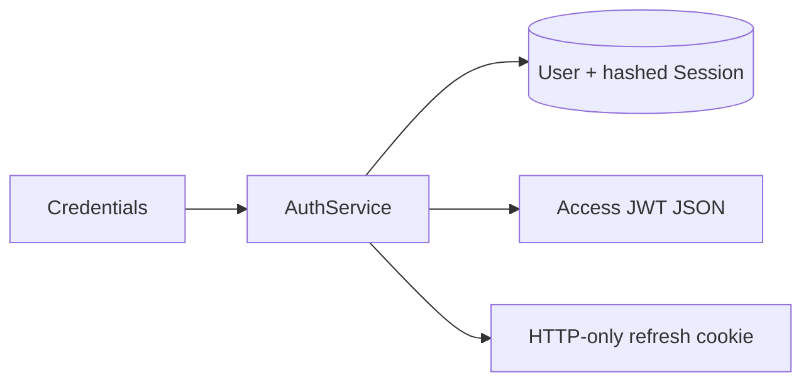

### Chat creation

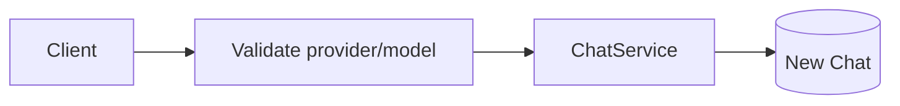

### Normal AI message

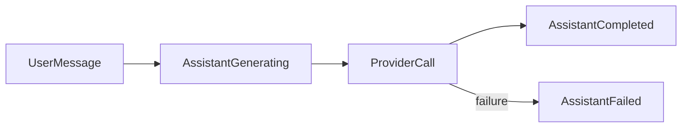

### Streaming AI message

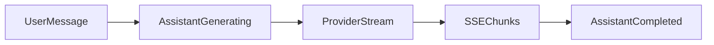

### Cancellation

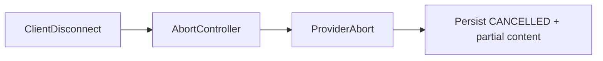

### Retry

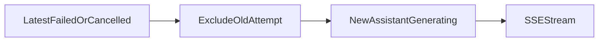

### Regenerate

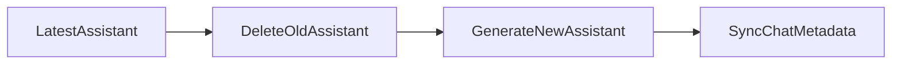

### Edit and resend

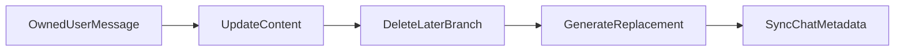

### Attachment upload

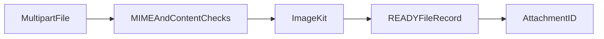

### Context and summarization

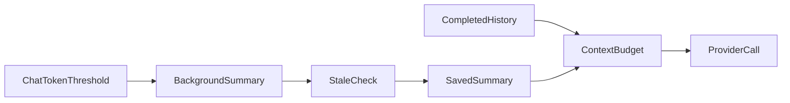

## 34. Important Business Rules

- A user can access only chats they own.
- A user can access a message only through an owned chat.
- A file can be attached only when every referenced file exists, belongs to the caller, and is `READY`.
- Only supported provider/model pairs are accepted.
- Attachment-bearing messages are allowed only for Gemini chats; Groq attachment requests fail with `400`.
- Only latest assistant messages can be regenerated.
- Only latest failed/cancelled assistant messages can be retried.
- Retry creates a new assistant message and retains the old failed/cancelled record.
- Edit is restricted to user messages and deletes every later message before regeneration.
- Context and summary selection skip non-completed messages.
- Cancellation preserves partial output and uses `CANCELLED`, not `FAILED`.
- Chat token totals are historical consumption and are not refunded after message deletion.
- Overlapping protected message mutations in one process are rejected rather than queued.

## 35. Frontend Integration Contract

### Authentication

1. Register or log in and save the JSON `accessToken` in the frontend's chosen access-token state.
2. Include `Authorization: Bearer <accessToken>` on protected requests.
3. Use credential-enabled browser requests for register/login if the client needs the response cookie, and always for refresh/logout.
4. When access authentication fails, call `POST /auth/refresh` with credentials; it returns a new access token but does not rotate the cookie.
5. Clear client-side access-token state after logout or unrecoverable refresh failure.

### Chats

Use the active and archived list endpoints separately. Preserve the returned pagination object. Only send listed update fields. If switching provider without choosing a model, let the backend select the compatible default. Do not expose unsupported model options in the UI.

### Messages and loading states

- Treat a normal send as pending until its JSON response resolves.
- For SSE, display token content as `chunk` frames arrive.
- On `done`, fetch messages or reconcile the returned `messageId` with local state to obtain complete persisted metadata.
- Show persisted `GENERATING`, `COMPLETED`, `FAILED`, and `CANCELLED` values from message reads.
- Offer retry only for the latest `FAILED`/`CANCELLED` assistant message and regenerate only for the latest assistant message.
- Editing a user message replaces the later conversation branch; the UI should communicate that it is not an append-only edit.

### SSE and cancellation

The SSE endpoints require an `Authorization` header. Browser `EventSource` does not natively let callers set that header, so the frontend needs an SSE-capable request approach that can send the bearer token, such as `fetch` plus streamed response parsing. This is an integration constraint derived from the current API, not a prescribed frontend framework.

To cancel, abort the streaming HTTP request or close its connection. There is no cancel API route. The backend stores the partial assistant response as `CANCELLED`; a disconnected client must refresh/reload messages to inspect that final state.

### Attachments

1. Upload exactly one file to `/files/upload` using multipart form data and a bearer token. Any field name is accepted.
2. Read the returned file ID.
3. Send that ID in the message `attachments` array.
4. Enable attachment UI only for Gemini chats unless the frontend intentionally handles the backend's `400` response for Groq.

### Errors

Use `success`, `message`, and `errors` from JSON responses. Validation errors provide field paths. Do not render raw provider/internal errors as a contract; 5xx messages are intentionally sanitized. SSE errors use the event JSON format rather than the standard response envelope.

## 36. Environment Configuration

Use `server/.env.example` as the variable-name template. Do not commit secret values.

### Required at startup

```text
MONGODB_URI=MongoDB connection URI
CLIENT_URL=Allowed browser origin for CORS
JWT_ACCESS_SECRET=Signing secret for access JWTs
JWT_REFRESH_SECRET=Signing secret for refresh JWTs
IMAGEKIT_PUBLIC_KEY=ImageKit public key
IMAGEKIT_PRIVATE_KEY=ImageKit private key
IMAGEKIT_URL_ENDPOINT=ImageKit URL endpoint
GEMINI_API_KEY=Gemini API key, required unless GROQ_API_KEY is set
GROQ_API_KEY=Groq API key, required unless GEMINI_API_KEY is set
```

At least one AI provider key is required. The provider/model validators do not check whether a selected provider's key is configured; selecting an unconfigured provider reaches that provider and will fail as a normalized provider error.

### Optional/defaulted

```text
NODE_ENV=Defaults to development
PORT=Defaults to 5000
ACCESS_TOKEN_EXPIRES=Defaults to 15m
REFRESH_TOKEN_EXPIRES=Defaults to 7d; must be a positive integer plus s, m, h, d, or w
```

`REFRESH_TOKEN_EXPIRES` controls both the refresh JWT expiry and cookie maximum age.

## 37. Development Setup

1. Install server dependencies:

```bash
cd server
npm install
```

2. Create `server/.env` from `.env.example` and supply the required values. Ensure the configured MongoDB instance is reachable.

3. Start development mode:

```bash
npm run dev
```

4. Start without Nodemon:

```bash
npm start
```

5. Run lint:

```bash
npm run lint
```

6. The repository has no named syntax-check script. A direct Node syntax check can be run for individual files, for example:

```bash
node --check src/server.js
```

`npm run lint:fix` and `npm run format` modify files; use them only when a code-formatting change is intended.

## 38. Testing & Verification

### Verified in this documentation pass

- Inspected all current server source modules, route mounts, request validators, controllers, services, repositories, models, middleware, configuration, AI providers/adapters, storage providers, shared utilities, package scripts, `.env.example`, and all pre-existing Markdown documentation.
- Cross-checked route paths, methods, request validation, API response envelope, SSE frames, provider/model allow-lists, token/context constants, and file limits against source.
- Confirmed no automated test script and no server test files in the inspected tree.

### Prior verification recorded by the repository

`BACKEND_STATUS_REPORT.md` records prior lint, syntax, live API, provider, lifecycle, cancellation, retry, counter, token, and cleanup checks. This final documentation pass did not independently rerun those live checks; it treats the report as historical verification evidence and the source as the API contract.

### Not automated / not verified here

- A formal unit/integration test suite and CI pipeline are not currently documented or present in `server/package.json`.
- Production deployment, horizontal multi-instance behavior, and external service account configuration were not independently verified in this documentation pass.

## 39. Production Readiness

The backend has implemented request validation, response sanitization, bearer/session auth, ownership checks, password and refresh-token hashing, CORS, Helmet, rate limiting, body/file limits, provider normalization, file MIME/content checks, and a source-level API contract suitable for frontend integration.

Operational readiness is bounded by the configured MongoDB, ImageKit, and AI-provider credentials. The current code starts only after environment validation and MongoDB connection succeed. Production deployments should account for the limitations in the next section, especially multi-instance mutation coordination and lack of refresh-token rotation.

## 40. Known Limitations

- The per-chat mutation lock is in-memory and does not coordinate multiple server instances.
- Refresh tokens are not rotated during refresh.
- Session expiration is enforced by `expiresAt` query checks, but the schema has no verified MongoDB TTL `expire` setting for automatic expired-record cleanup.
- Conversation summaries are asynchronous; failures are only logged, and stale summaries are discarded after consuming summary-call token usage.
- Only Gemini supports message attachments. Groq attachment requests are rejected.
- The public file API only uploads files; list/get/delete file endpoints are not mounted.
- ImageKit is the active upload provider. The local provider is a non-functional stub.
- The server permits startup with one AI provider key, but its public provider/model selection can still target the unconfigured provider and yield a provider error.
- No automated test runner/test suite was found in the server project.
- `systemPrompt` is stored in the Chat schema but not configurable through the current public chat API.

## 41. Architectural Decisions

### Layered Express backend

- **Decision:** Separate routes, middleware, controllers, services, repositories, and models.
- **Reason:** Keep HTTP concerns, business rules, and persistence operations independently understandable.
- **Current implementation:** Every implemented feature module follows this pattern, with shared middleware/utilities.
- **Constraint:** Cross-module changes need to preserve the service/repository responsibility boundaries.

### Provider abstraction

- **Decision:** Use AI service, factory, provider contract, and adapters.
- **Reason:** Gemini and Groq have different SDK contracts, role conventions, stream chunks, and usage fields.
- **Current implementation:** Both providers return normalized response/stream data.
- **Constraint:** Only the provider/model values in `AI_PROVIDER_MODELS` are accepted.

### SSE for live generation

- **Decision:** Stream response tokens over SSE-compatible HTTP responses.
- **Reason:** The API can deliver incremental text while preserving normal REST endpoints for other operations.
- **Current implementation:** `POST /messages/stream` and retry stream write `data:` frames and use request/response disconnect signals for cancellation.
- **Constraint:** The bearer header means browser integration needs a header-capable streaming request mechanism.

### Server-tracked refresh sessions

- **Decision:** Pair refresh JWTs with hashed database sessions.
- **Reason:** Supports logout/revocation and avoids storing raw refresh credentials in MongoDB.
- **Current implementation:** Session lookup validates hash, revocation, expiry, and referenced user.
- **Constraint:** Tokens do not rotate, and automatic TTL cleanup is not verified.

### Historical token accounting

- **Decision:** Never decrement chat usage after message deletion.
- **Reason:** Token totals represent provider consumption rather than current conversation contents.
- **Current implementation:** Increment on successful assistant/summarization usage; no decrement paths.
- **Constraint:** Current visible messages do not sum to historical chat usage after branch changes.

### ImageKit-backed memory uploads

- **Decision:** Validate a memory-buffered file, upload it to ImageKit, then persist a ready record.
- **Reason:** Avoids marking a file ready in MongoDB before remote storage succeeds.
- **Current implementation:** File service validates then calls ImageKit through storage service.
- **Constraint:** One 10 MiB file per request; local provider is not implemented.

## 42. Historical Troubleshooting Notes

The existing historical notes remain available and are not duplicated here.

| Problem | Root cause | Current solution |
| --- | --- | --- |
| Groq invalid role rejection | Shared stored/conversation roles may be uppercase or provider-neutral. | `buildGroqMessages` maps roles to valid lower-case `user`, `assistant`, and `system` values. |
| Groq context budget | A provider needs a bounded input window. | Message context uses the Groq 7000-token estimated budget; summaries also have bounded input/output budgets. |

See `GROQ_INVALID_ROLE_ROOT_CAUSE.md` and `GROQ_INVALID_ROLE_ROOT_CAUSE012.md` for the concise historical records.

## 43. Current Project Status

| Area | Status |
| --- | --- |
| Backend foundation | Implemented |
| Authentication and authorization | Implemented |
| User profile | Implemented |
| Chat system | Implemented |
| Message system | Implemented |
| Gemini and Groq abstraction | Implemented |
| Streaming and cancellation | Implemented |
| Retry, regenerate, edit and resend | Implemented |
| Attachments and ImageKit uploads | Implemented, Gemini-only for message use |
| Security hardening | Implemented controls documented; production limitations remain |
| Automated tests | Not present/verified in the inspected server project |
| Documentation | Complete with this document |
| Frontend | Next phase; not documented as implemented |

## 44. Next Development Phase

The next logical phase is frontend development. The backend contract is now established around `/api/v1`, bearer access tokens, credentialed refresh cookies, JSON response envelopes, and authenticated SSE streams. Frontend work should use this document and the existing endpoint/auth references as the integration baseline without assuming unimplemented client features.
